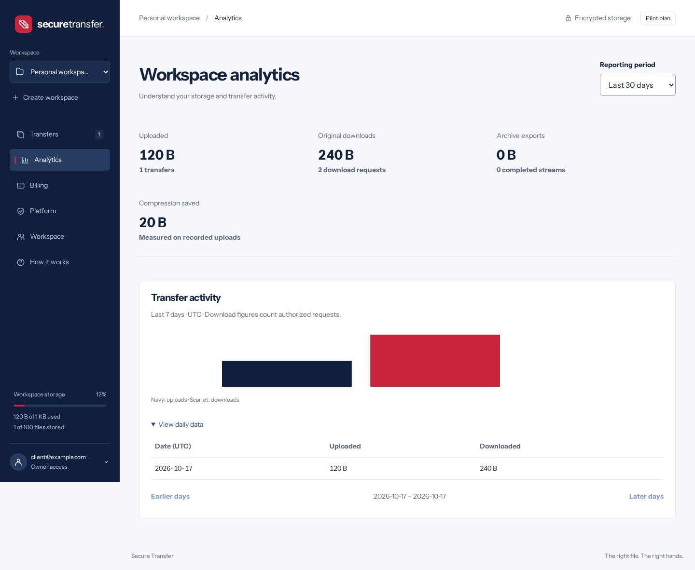
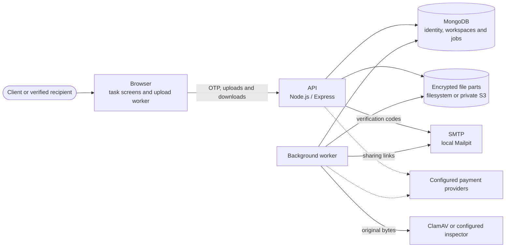
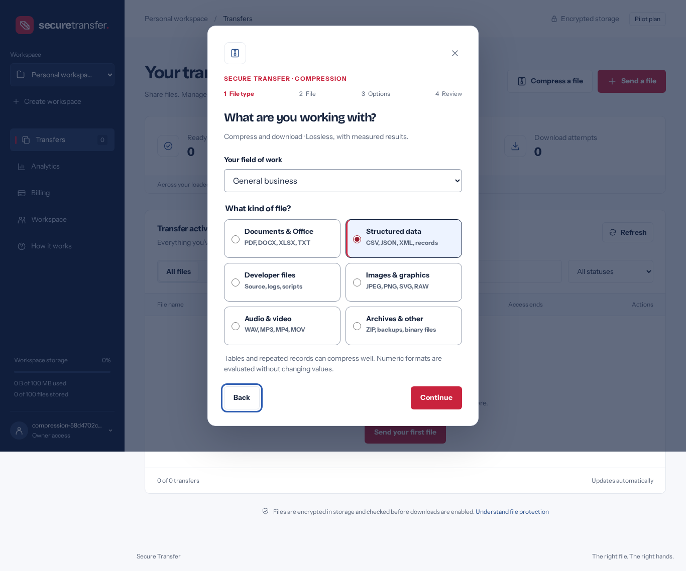

# Secure Transfer — Encrypted File Sharing and Lossless Compression

[](https://github.com/Alex-Muhscience/Secure-File-Sharing-App/actions/workflows/node.js.yml)

File sharing and lossless compression for individuals and teams that need verified recipients, controlled access and visibility into their storage and transfers. Secure Transfer uploads files in resumable chunks, compresses and encrypts stored content, checks it for malware, and gives the recipient an access link. Clients have usage and billing dashboards; platform operators have a separate dashboard for managing client workspaces and subscriptions.

**Current release: v0.6.0 — a working local pilot.** Core workflows are implemented and tested. Production operation, live payment acceptance and actual terabyte capacity remain unfinished. Secure Transfer is the working product name; final branding is undecided.



Screenshots show the current interface with synthetic test data, not customer usage or performance results.

## What works today

| Component                                                                                                                                  | Path                                                                                         | Status                                                                                                                                              |
| ------------------------------------------------------------------------------------------------------------------------------------------ | -------------------------------------------------------------------------------------------- | --------------------------------------------------------------------------------------------------------------------------------------------------- |
| **Client interface**: send, compress/download, compress/send, restore, transfer history, usage analytics and billing                       | [`public/`](public)                                                                          | Working. Vanilla JavaScript, focused task screens and a navy, scarlet and white palette; keyboard, reflow and automated accessibility checks.       |
| **API and workspaces**: email OTP, sessions, personal/team workspaces, roles, quotas and access revocation                                 | [`src/app.js`](src/app.js), [`src/organization-routes.js`](src/organization-routes.js)       | Working. Node 24, Express 5 and MongoDB. Workspace selection never overrides file authorization.                                                    |
| **Compression engine**: independent STP1 predictor/block packer, Brotli/Zstandard comparison, STC1 and gzip exports                        | [`src/compression.js`](src/compression.js), [`src/stc-codec.js`](src/stc-codec.js)           | Working. Lossless, with exact-byte restore checks and published per-file measurements. Ratio and speed targets still have misses.                   |
| **File pipeline and storage**: resumable uploads, bounded encrypted parts, authenticated manifests and original downloads with byte ranges | [`src/segments.js`](src/segments.js), [`src/storage.js`](src/storage.js)                     | Working with filesystem storage or private Garage S3. Configurable large-file limits are not validated terabyte capacity.                           |
| **Background processing**: quarantine, malware inspection, inspected archive restore, notification retries and cleanup                     | [`src/worker.js`](src/worker.js), [`src/restore-job.js`](src/restore-job.js)                 | Working with ClamAV and local Mailpit. Scanner outages retain quarantine for retry; local email is captured, not delivered externally.              |
| **Platform administration**: client search, guarded manual subscriptions, access suspension and aggregate analytics                        | [`src/platform.js`](src/platform.js)                                                         | Working. Operators must be explicitly allowlisted on the server and verify their email. Domain ownership alone grants no access.                    |
| **Payments**: Stripe recurring/prepaid, M-Pesa prepaid and optional BitPay prepaid                                                         | [`src/payments.js`](src/payments.js), [`src/payment-providers.js`](src/payment-providers.js) | Integration code and automated fixtures exist. Checkout defaults off; merchant accounts, prices/currency and sandbox acceptance are still required. |
| **Recovery tools**: encrypted snapshots, isolated restore, storage migration and key rotation                                              | [`scripts/`](scripts), [`src/archive.js`](src/archive.js)                                    | Working in local filesystem/S3 tests. Production key custody, offsite retention and recovery drills remain operator work.                           |

The [implementation guide](docs/IMPLEMENTATION.md) maps the modules, API and trust boundaries. [Delivery status](docs/DELIVERY_STATUS.md) owns current readiness and remaining priorities; the tables here are an introduction, not a separate acceptance record.

## How it fits together



1. A client verifies their email, selects a workspace and chooses **Send a file**, **Compress and download**, **Compress and send**, or **Restore**. Six file categories provide guidance for documents/office files, structured data, developer files, images, audio/video and archives/other files.
2. The API checks identity, workspace roles, subscription access and original-byte quota. Uploads save bounded encrypted parts with durable offsets so an interrupted upload can resume. Compression preserves the original bytes; it does not resize images or transcode media.
3. The worker inspects the original before making it available. Restore jobs verify the archive, reconstruct the original and inspect that original too. Files stay quarantined when inspection is unavailable.
4. The client downloads the original or a `.stc`/`.gz` export. Shared transfers send an access link by email; the recipient verifies their email before downloading. Private compression and restore jobs require no recipient and send no notification.

The server holds the keys needed to inspect and serve files. Stored-file encryption is server-managed, not end-to-end encryption. Downloaded `.stc` and `.gz` archives are unencrypted; the STC restore screen accepts Secure Transfer archives, while gzip exports use ordinary gzip tools. See [formats and offline restore](docs/COMPRESSION.md).



## Quick start

You need Node **24.19+ in the 24.x line** to generate local settings, and Docker with Compose v2 to run the stack. The tested release runtime is Node 24.21.0. ClamAV has a 2 GiB container memory limit; allow additional memory for the app, worker, MongoDB and Docker.

For a new filesystem installation:

```bash
git clone https://github.com/Alex-Muhscience/Secure-File-Sharing-App.git
cd Secure-File-Sharing-App
node scripts/init-local.cjs
docker compose --env-file /dev/null -f compose.app.yaml up -d --build --wait
```

Open **http://localhost:3081** and the local email inbox at **http://localhost:8025**. Sign in with your email, read the verification code in Mailpit, then try **Send a file** or **Compress a file**. The default accepted file size is **10 MiB**. New installations have no platform administrator until an email is explicitly configured.

**[The operations guide](docs/OPERATIONS.md)** covers configuration, administrator setup, private S3 storage, migration, backups, recovery, testing and deployment preparation. The [API reference](docs/IMPLEMENTATION.md#api) describes the endpoints and authentication lifecycle.

### Existing installations and S3

Keep the installation's environment files, encryption/backup keys, volumes and configured storage mode. If S3 is configured or retained S3 objects still exist, keep the overlay when updating:

```bash
docker compose --env-file .env.s3 -f compose.app.yaml -f compose.s3.yaml up -d --build --wait
```

First-time S3 setup and migration have their own steps in [operations](docs/OPERATIONS.md#private-s3-storage-and-migration-v040). The initializers preserve existing credentials. The working application uses `compose.app.yaml`, optionally with `compose.s3.yaml`; `compose.local.yaml` is the separate port-3080 interface preview, and the legacy `docker-compose.yml` is not the current launch command.

This development workspace additionally uses **http://secure-transfer.localhost:3081**, the allowlisted email `admin@secure-transfer.localhost`, and private Garage S3. Those are ignored local settings, not administrator access shipped to every clone.

## Development

For source and UI checks, install dependencies and Chromium:

```bash
npm ci --ignore-scripts
npx playwright install chromium
```

| What                                                               | How                                                                                                                            |
| ------------------------------------------------------------------ | ------------------------------------------------------------------------------------------------------------------------------ |
| JavaScript syntax                                                  | `npm run check`                                                                                                                |
| Tracked-file secret check                                          | `npm run check:secrets`                                                                                                        |
| Unit tests                                                         | `npm test`                                                                                                                     |
| UI, accessibility, refresh/expiry and workspace/action race checks | `npm run test:ui`                                                                                                              |
| MongoDB and real Garage S3 integration suites                      | Use the private-network commands in the [verification runbook](docs/OPERATIONS.md#verification).                               |
| Browser workflows against the running filesystem stack             | `BROWSER_STORAGE=filesystem npm run test:browser`                                                                              |
| Browser workflows against the running S3 stack                     | `BROWSER_STORAGE=s3 npm run test:browser`                                                                                      |
| Codec comparisons and transfer benchmarks                          | Commands and measurement boundaries in [compression evidence and reproduction](docs/COMPRESSION.md#evidence-and-reproduction). |

Integration suites use isolated temporary databases and object prefixes. Packaged browser tests need the real app, MongoDB, scanner and Mailpit; rebuild the images after server changes so the tests exercise the changed code. The UI/race suites use controlled API fixtures and explicit clock control for manual/background refresh and expiry. Browser output and local benchmark inputs stay ignored.

Use a branch and pull request, update the document that owns each changed fact, and ask the repository owner before merging. Commit messages contain no assistant attribution. GitHub automatically deletes source branches after an approved merge; update and verify local `main`, then remove the corresponding merged local branch.

### Continuous integration

Every pull request and push to `main` runs [Transfer checks](.github/workflows/node.js.yml):

- syntax, tracked-secret and production-dependency audit checks
- unit and MongoDB integration suites
- Chromium UI, accessibility, layout and race checks
- the packaged filesystem stack, real scanner/email smoke tests and browser transfer/compression/restore workflows
- the private Garage S3 stack, integration and browser workflows against it
- encrypted backup verification for both storage configurations

Passing these checks verifies the exercised workflows. The [delivery record](docs/DELIVERY_STATUS.md#evidence-already-available) links release evidence and distinguishes it from production and customer acceptance.

## Roadmap

The current work and evidence needed to accept it are in [delivery status](docs/DELIVERY_STATUS.md#what-remains-in-priority-order). The near-term list:

Done:

- [x] Email OTP, expiring sessions, verified-recipient access and revocation
- [x] Personal/team workspaces, owner/admin/member/viewer roles and atomic quotas
- [x] Compact client screens, usage/billing dashboards and explicit platform administration
- [x] Encrypted resumable uploads, malware quarantine and native original downloads with byte ranges
- [x] Six-category compress/download, compress/send and inspected STC restore workflows
- [x] Independent STP1 codec, established-codec comparisons and published ratio/speed results
- [x] Filesystem/private S3 storage, verified migration, key rotation and encrypted recovery tools
- [x] Stripe, M-Pesa and optional BitPay integration code, with checkout off until configured and accepted
- [x] Automated unit, integration, UI/accessibility/race and packaged browser checks

Next:

- [ ] Improve compression and transfer speeds using representative client files and devices, including the reported LAN/tiny-file regressions
- [ ] Provision and validate actual 1–5 TB upload, full-byte inspection, interruption, recovery and resource bounds
- [ ] Complete production HTTPS, provider-credential rotation, managed key custody, redundancy, offsite retention, monitoring and independent security review
- [ ] Configure merchant accounts, currency/prices and accept real provider sandbox lifecycles
- [ ] Agree and finish refund, dispute, fee, tax, accounting and payment-support operations
- [ ] Finalize branding, domain, operator identity, licensing and real email delivery; complete client usability, human accessibility and supported-browser acceptance
- [ ] Agree and implement any additional enterprise requirements such as SSO/SCIM, regional residency and external immutable audit retention

The 75% lossless reduction target is not a guarantee. The best tested settings meet it on **5/8 nonempty synthetic fixtures**; custom STP1 meets it on **0/8** of that general set and achieves **86.96%** on a separate correlated-data probe. WAN gains coexist with LAN/tiny-file regressions, so the new compression workflow stays opt-in. See the [full results and misses](docs/benchmarks/2026-10-18-summary.md).

The default accepted file size remains **10 MiB**, and the included ClamAV stream cap is **25 MiB**. The configuration ceiling of **5 TiB** is not an actual-size validation result. Increasing one limit alone does not establish service capacity; [large-file requirements](docs/LARGE_FILES.md) cover the remaining work.

## Security

- Stored files use server-managed AES-GCM encryption, wrapped keys and authenticated manifests. Operators with the keys can decrypt; portable STC/gzip exports are unencrypted.
- File access checks identity, current roles, expiry, revocation and subscription access. A workspace selection or local email domain never creates authority.
- Files are inspected before release. Do not bypass quarantine or treat the configurable HTTPS inspector contract as a bundled terabyte scanning service.
- Keep credentials, environment files, keys, customer content, generated exports and local recovery material out of commits. The root [`.gitignore`](.gitignore) covers these operational artifacts.

Deployment and key-management procedures live in [operations](docs/OPERATIONS.md). Industry labels do not establish regulatory certification, and the local pilot does not establish a production SLA.

## Repository history

This repository started as an incomplete file-sharing prototype. The application was rebuilt around verified email identities, authenticated encrypted storage and a working local stack, then extended with team workspaces, quarantine, private S3, enterprise dashboards, provider billing flows and resumable uploads. v0.6.0 added industry-oriented compression and inspected restore workflows with explicit measurement results.

The [release history and evidence index](docs/IMPLEMENTATION.md#release-history-and-evidence) records those milestones. Historical audits and plans retain their original scope; [delivery status](docs/DELIVERY_STATUS.md) is the current backlog. Legacy prototype paths and the old preview are identified in the [repository map](docs/IMPLEMENTATION.md#deployment-files-and-historical-artifacts).

## Licence

No application licence has been selected yet; licensing and commercial terms remain an owner decision. Third-party font notices are kept in [`public/fonts/`](public/fonts).
