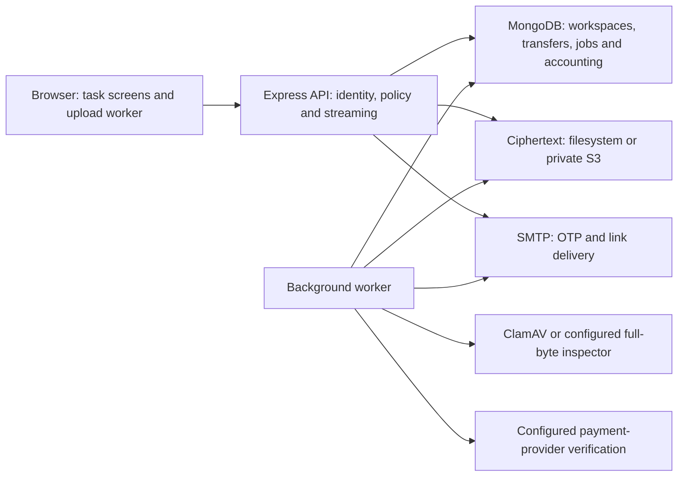

# Implementation and repository map

This is the current technical map for **v0.6.0**, reconciled on **2026-10-18** after [PR #8](https://github.com/Alex-Muhscience/Secure-File-Sharing-App/pull/8) merged. It replaces the earlier foundation-only progress narrative. [Delivery status](DELIVERY_STATUS.md) owns readiness and remaining work; the [release history below](#release-history-and-evidence) preserves the milestones.

## Product concepts

| Term | Meaning in this application |
| --- | --- |
| Client / workspace | A personal or team organization with members, storage/file/seat limits and subscription access |
| Recipient | A verified email identity granted access to a shared transfer; workspace selection does not create permission |
| Workspace owner/admin | A role inside one workspace; manages permitted members, reporting and settings. Checkout is owner-only. |
| Platform operator | An email explicitly allowlisted on the server and verified by OTP; manages client metadata, manual plans, suspension and aggregate analytics |
| Original | The exact uploaded file bytes, including its existing internal metadata/signatures; lossless restore must reproduce them |
| Part / chunk | A bounded unit used for resumable upload, compression, authenticated encryption and streaming access |
| Profile / industry | File-category metadata and client guidance; never authority to choose an unsafe decoder, bypass inspection or claim certification |
| Ready | Inspection and publication completed; current access, expiry and subscription rules still apply |

Sending creates a hosted transfer and an email link. It does not attach the file to email. Private compression and restore jobs omit the recipient and notification. The local inbox captures messages rather than delivering them externally.

## Runtime architecture

The active stack uses Node 24, Express 5, the native MongoDB driver, vanilla browser JavaScript, worker threads, ClamAV, Mailpit and filesystem/private S3 adapters. A separate process runs background jobs using the same application entry point with `WORKER_ONLY=true`.

The server can decrypt stored content to inspect and serve authorized reads. The browser does not hold exclusive decryption keys. This is server-managed encryption, not end-to-end encryption.

## Transfer, compression and restore lifecycle

1. The API verifies identity, current membership/subscription and immutable upload settings, then reserves original-byte/file quota. A fingerprint helps reselect the same local file; it is not a full-file identity proof.
2. The browser can compress a bounded chunk before transmission. Logical offset/length and SHA-256 describe original bytes. The API bounds and decodes the allowlisted wire codec, verifies original size/hash, and commits sequential durable offsets.
3. Storage evaluates configured codecs, encrypts each part with AES-GCM and persists authenticated descriptors. Completion verifies an ordered keyed manifest and publishes a **quarantined** transfer, with idempotent accounting repair.
4. The worker inspects the original. Clean files become active; infected/invalid files are blocked. Infrastructure/scanner errors retain quarantine for retry. Shared files queue link notifications; private jobs do not.
5. An authorized user can download the exact original or a generated STC/gzip representation. Current permission checks continue during streaming. Originals support single byte ranges; regenerated archives restart after interruption. Complete export sizes and original-download requests use separate counters.
6. A server restore accepts **STC1**, reserves room for the reconstructed original as well as the input archive, verifies all framing/hashes/finality, writes encrypted internal staging parts and scans the reconstructed file. Only a verified child becomes available. Internal stages are excluded from public resumable routes; durable checkpoints and completion recording recover across failures.

Once a job/session is saved, its action, recipient and compression settings remain bound to that job. After a polling failure or lost completion response, Retry continues it; close and start a new job to change settings. Revocation/expiry denies access immediately while physical cleanup and quota release are retryable background work.

## Formats and protection boundaries

| Format or representation | Purpose | Protection / compatibility |
| --- | --- | --- |
| `part-v1` and `segments-v1` | Encrypted storage parts and ordered root manifest | Per-part AES-256-GCM, wrapped keys and a keyed manifest; not a downloadable portable archive |
| STP1 / `stp1` | Our custom lossless predictor/block-packing codec | A documented compression bitstream with checksums; not encryption and not Brotli/Zstandard under another name |
| STC1 / `.stc` | Portable single-file archive with explicit codecs, frames, checksums and finality | Unencrypted export; restore through the UI or `scripts/stc.cjs` using the supported runtime |
| `.gz` | Standard gzip export | Unencrypted; use ordinary gzip tools. The STC restore screen/CLI does not extract gzip, ZIP or RAR. |
| STBK2 / `.enc` snapshots | Operational recovery of metadata and encrypted objects | Authenticated libsodium secretstream backup; `scripts/backup.cjs`, not the client archive-restore screen |
| Legacy GCM and STBK1 | Previously supported files and snapshots | Retained readers; the older CBC prototype needs a separate inventory/migration |

No custom encryption primitive is introduced. [Compression](COMPRESSION.md) owns byte-level archive/codec contracts, [large files](LARGE_FILES.md) owns scale/inspection constraints, and [operations](OPERATIONS.md) owns recovery and key handling.

## Where the code lives

| Concern | Active source / evidence |
| --- | --- |
| Startup, graceful shutdown and separate worker scheduling | [app.js](../app.js), [configuration](../src/config.js), [database/indexes](../src/database.js) |
| Identity, OTP/session lifecycle, original files, native tickets and request policy | [application/API](../src/app.js), [pilot policy and quotas](../src/pilot.js), [authorization tests](../test/authorization.cjs) |
| Workspaces, platform administration and reporting | [organization routes](../src/organization-routes.js), [platform](../src/platform.js), [analytics](../src/analytics.js), [enterprise tests](../test/enterprise.cjs) |
| Payment catalog, providers, orders and reconciliation | [payment configuration](../src/payment-config.js), [providers](../src/payment-providers.js), [payments](../src/payments.js), [billing](../src/billing.js), [ordering tests](../test/payment-ordering.cjs) |
| Resumable parts, encrypted storage and range reads | [segments](../src/segments.js), [parts](../src/parts.js), [storage](../src/storage.js), [object adapters](../src/object-store.js), [ranges](../src/ranges.js) |
| Custom codec, established codecs and wire decoding | [portable STP1 core](../public/stc-codec-core.js), [Node wrapper](../src/stc-codec.js), [registry](../src/compression.js), [encoder worker](../src/compression-worker.js), [wire decoder](../src/chunk-transport.js), [profiles](../src/file-profiles.js) |
| Client archives, exports and inspected restore | [STC1](../src/compressed-archive.js), [export routes](../src/compression-routes.js), [restore jobs](../src/restore-job.js), [offline CLI](../scripts/stc.cjs), [integration coverage](../test/compression.cjs) |
| Scanning, notifications and maintenance | [worker](../src/worker.js), [scanner](../src/scanner.js), [held-scan maintenance test](../test/worker-maintenance.cjs) |
| Snapshots, backend migration and key rotation | [backup format](../src/archive.js), [backup CLI](../scripts/backup.cjs), [migration](../src/migration.js), [key rotation CLI](../scripts/rotate-keys.cjs), [S3 recovery tests](../test/segmented-s3.cjs) |
| Browser interface and client workers | [HTML](../public/index.html), [main UI](../public/script.js), [compression UI](../public/compression-ui.js), [resumable client](../public/resumable.js), [upload worker](../public/upload-compression-worker.js), [dashboards](../public/dashboards.js), [billing UI](../public/billing-ui.js) |
| Design and accessibility | [interface reference](../design.md), [tokens](../public/tokens.css), [styles](../public/styles.css), [UI checks](../test/ui-browser.js), [race checks](../test/ui-races.js), [compression browser flows](../test/compression-browser.js) |
| Reproducible measurements | [codec harness](../scripts/benchmark-codecs.cjs), [transfer harness](../scripts/benchmark-transfers.cjs), [corpus generator](../scripts/benchmark-corpus.cjs), [published results](benchmarks/2026-10-18-summary.md) |

## Deployment files and historical artifacts

| Path | Role |
| --- | --- |
| [compose.app.yaml](../compose.app.yaml) | Working local app, background worker, MongoDB, ClamAV and Mailpit; application port 3081 |
| [compose.s3.yaml](../compose.s3.yaml) | Optional private Garage S3 overlay; keep it whenever live/retained S3 references require it |
| [Dockerfile](../Dockerfile) | Current Node application/worker image; production dependencies only |
| [.env.example](../.env.example) | Credential-free configuration vocabulary; initializers generate ignored local values |
| [.github/workflows/node.js.yml](../.github/workflows/node.js.yml) | CI verification for both storage backends |
| [compose.local.yaml](../compose.local.yaml), [docker/local/preview.cjs](../docker/local/preview.cjs) | Interface-only historical preview at port 3080; transfers/verification are disabled there |
| [Deployment.yaml](../Deployment.yaml) | Single-instance Kubernetes application template; not a complete production environment |
| [docker-compose.yml](../docker-compose.yml) | Legacy deployment template with outdated configuration and dependencies; do not use as the current launch command |
| `middleware/`, `models/`, [utils.js](../utils.js), [root tokens.css](../tokens.css) | Historical prototype artifacts, not imported by the current entry point. Current application modules are under `src/`; current UI tokens are under `public/`. |

Keeping an old file is not a commitment to restore its behavior. Do not use preview health, old Mongoose models or the legacy deployment template as evidence about the active runtime. Removing these artifacts is a separate scoped change.

## API

Protected API requests use `Authorization: Bearer <token>` and optional `X-Organization-ID` (otherwise the personal workspace). Workspace selection never overrides authorization.

| Method | Path | Purpose |
| --- | --- | --- |
| GET | `/health`, `/ready`, `/api/config` | Health and safe client configuration |
| POST | `/api/request-otp`, `/api/verify-otp`, `/api/logout` | Email verification and session revocation |
| GET | `/api/me` | Verified identity and explicit platform privilege |
| GET / POST | `/api/organizations` | List/create workspaces |
| PUT / DELETE | `/api/organizations/:id/members[/:email]` | Role/member management |
| GET / POST | `/api/uploads` | Resume list / create encrypted upload |
| GET / DELETE | `/api/uploads/:id` | Offset/status / discard partial upload |
| PUT | `/api/uploads/:id/chunks` | Bounded raw/compressed chunk; original `Upload-Offset`, `X-Chunk-SHA256`, explicit wire codec/length |
| POST | `/api/uploads/:id/complete` | Verify ordered manifest, finalize and quarantine |
| POST | `/api/upload` | Bounded legacy multipart upload |
| GET | `/api/files` | Authorized recent transfers, optional `transfer` UUID lookup |
| GET | `/api/file/:id/download` | Bearer-authenticated attachment; single byte ranges |
| GET | `/api/file/:id/export/{stc,gzip}` | Guarded streaming compressed archive; no byte ranges |
| GET | `/api/file/:id/compression` | Authorized job status, codec counts and measured export sizes |
| POST | `/api/file/:id/download-ticket` | One-use native-download handoff |
| GET | `/api/download/:ticketOrFileId[/{stc,gzip}]` | One-use handoff or file/representation-scoped browser attachment |
| DELETE | `/api/file/:id` | Revoke immediately and queue physical deletion |
| GET | `/api/usage`, `/api/analytics`, `/api/billing/overview` | Tenant usage, analytics and billing |
| POST | `/api/billing/checkout`, `/api/billing/portal` | Owner-only configured checkout/provider portal |
| GET | `/api/billing/orders/:id` | Owner-only payment status |
| POST | `/api/payments/stripe/webhook`, `/api/payments/{mpesa,crypto}/callback` | Signed Stripe events / untrusted verification hints |
| GET | `/api/platform/analytics`, `/api/platform/clients[/:id]` | Explicit operator analytics and client management |
| PUT | `/api/platform/clients/:id/subscription`, `/api/platform/clients/:id/access` | Guarded manual plan or application-access change |
| GET | `/api/audit/export`, `/api/operations` | Workspace administrator audit and worker status |
| POST | `/api/billing/sandbox/events` | Owner-only local entitlement simulation |

OTP codes expire after ten minutes, allow five attempts and can be consumed once. App tokens are hashed, expire after one hour and stay in browser memory. A native download uses a one-use 60-second handoff, then a file-scoped HttpOnly/SameSite cookie that lasts until transfer expiry so a large download can resume beyond app sign-in expiry. It cannot authenticate other APIs. Explicit logout revokes associated grants; file expiry, revocation, membership and billing are rechecked during streaming. Download counts/bytes describe authorized HTTP requests, including ranges/retries, not confirmed receipt.

## Release history and evidence

| Milestone | What changed | Historical record |
| --- | --- | --- |
| Original checkout, 2026-10-14 | An incomplete prototype had missing services/configuration and tracked runtime/credential material | [Original audit](../ENTERPRISE_AUDIT_AND_PLAN.md), [dated dependency snapshot](audit/npm-audit-2026-10-14.json); neither describes current dependency health |
| v0.2.0 foundation | Replaced the broken bootstrap with `src/` modules, validated keys, OTP/session handling, authenticated encryption, transfer authorization, safe UI and functional local stack | Git/tag history; the original audit remains the baseline record |
| v0.3.0 pilot | Added organizations/roles, atomic quotas, quarantine/scanning worker, notification retries, usage/sandbox events, key wrapping/rotation and encrypted recovery. Environment/dependency files were removed from tracking. | [Pilot CI](https://github.com/Alex-Muhscience/Secure-File-Sharing-App/actions/runs/38564171793); historical exposed credentials still require provider-side rotation |
| v0.4.0 storage | Added private S3/Garage, verified migration/reversal, cross-backend recovery and stronger current-state authorization/quota checks | [Merged PR #5](https://github.com/Alex-Muhscience/Secure-File-Sharing-App/pull/5) and [storage operations](OPERATIONS.md#private-s3-storage-and-migration-v040) |
| v0.5.0 enterprise | Added compact enterprise UI, operator/client dashboards, provider billing flows, encrypted resumable parts, native range downloads and STBK2 recovery; corrected subscription/session/UI races | [PR #6](https://github.com/Alex-Muhscience/Secure-File-Sharing-App/pull/6), [PR #7](https://github.com/Alex-Muhscience/Secure-File-Sharing-App/pull/7), [review record](RELEASE_REVIEW.md), [original plan](superpowers/plans/2026-10-17-enterprise-workspace.md) |
| v0.6.0 compression | Added six-category workflows, STP1/Brotli/Zstandard comparison, wire compression, STC1/gzip export, inspected server/offline restore and explicit ratio/speed evidence. Fixed saved-job reuse, internal stage isolation and gzip handoff. | [Merged PR #8](https://github.com/Alex-Muhscience/Secure-File-Sharing-App/pull/8), [review/merge record](RELEASE_V060.md), [design](superpowers/specs/2026-10-17-industry-compression-design.md), [original plan](superpowers/plans/2026-10-17-industry-compression.md) |

The historical documents retain their original scope, test counts and decisions. A past “not implemented” finding is not a current backlog item, and a past passing check is not a fresh production audit. For the current boundaries and next work, return to [delivery status](DELIVERY_STATUS.md).
